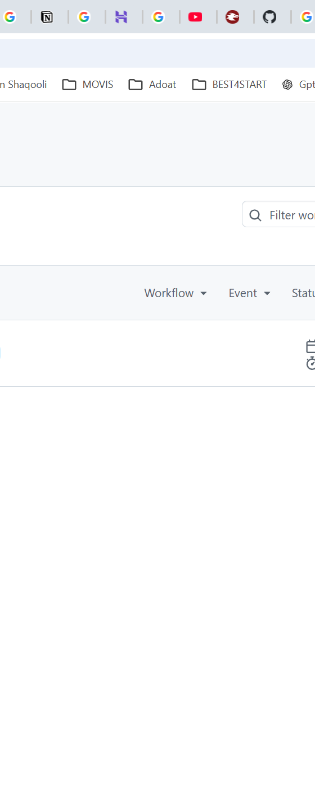

# DeskNote Sidebar

A native Windows desktop sidebar built with **Tauri 2**, **Rust**, and **React/TypeScript** that registers with the Windows Shell as an **Application Desktop Toolbar (AppBar)** — so maximized windows dock *around* it instead of opening behind it.




## Table of contents

- [Why an AppBar?](#why-an-appbar)
- [Features](#features)
- [Getting started](#getting-started)
- [Development](#development)
- [Build the Windows installer](#build-the-windows-installer)
- [How the native AppBar works](#how-the-native-appbar-works)
- [Multi-monitor behavior](#multi-monitor-behavior)
- [Fullscreen limitation](#fullscreen-limitation)
- [Project structure](#project-structure)
- [Documentation](#documentation)
- [Contributing](#contributing)
- [Security](#security)
- [License](#license)

## Why an AppBar?

A normal `alwaysOnTop` window floats *above* your maximized apps. DeskNote
instead tells Windows: *"reserve this strip of the work area for me."* The Shell
honors that reservation for every normal maximized window, so the sidebar sits
permanently beside your content without covering it — the same mechanism the
Windows taskbar uses.

## Features

- Real Windows Shell AppBar registration (`ABM_NEW` / `ABM_REMOVE`)
- Work-area reservation via `ABM_QUERYPOS` / `ABM_SETPOS`, kept in sync with
  `ABN_POSCHANGED` notifications
- Responds to display, DPI, settings, and native sizing-loop changes
- Left or right docking, multi-monitor selection
- DPI-aware logical sidebar width
- Optional topmost z-order
- Native Windows drag-to-resize divider (`WM_SIZING` sizing loop — no JS/IPC
  spam while dragging)
- Collapsible 56 px rail
- Persistent notes using WebView local storage
- Persistent UI settings
- Cleans up the AppBar reservation on exit
- Windows CI, lint checks, and a tag-triggered release pipeline
- Non-Windows preview mode compiles without the native AppBar behavior

## Getting started

### Requirements

1. **Windows 10 or 11**
2. **Node.js** 20 or newer
3. **Rust** stable with the MSVC toolchain:
   ```powershell
   rustup default stable-msvc
   ```
4. **Microsoft C++ Build Tools** with *Desktop development with C++*
5. **WebView2 Runtime** (normally preinstalled on current Windows)

### Quick start

```powershell
git clone https://github.com/rafa57600/desknote-sidebar.git
cd desknote-sidebar
npm install
npm run tauri dev
```

The app starts docked to the right side at 360 logical pixels. Open or
maximize another desktop application to verify that Windows reserves the
sidebar area.

## Development

| Command | Purpose |
| --- | --- |
| `npm run dev` | Vite dev server (frontend only) |
| `npm run build` | TypeScript check + production frontend build |
| `npm run tauri dev` | Full app in dev mode with hot reload |
| `npm run tauri build` | Production bundle (MSI/NSIS installers) |

See [CONTRIBUTING.md](CONTRIBUTING.md) for the full contributor setup,
project layout, and code style.

## Build the Windows installer

```powershell
npm install
npm run tauri build
```

Tauri writes release artifacts under:

```text
src-tauri/target/release/bundle/
```

## How the native AppBar works

`src-tauri/src/appbar/windows_impl.rs` does the following:

1. Gets the Tauri window's native `HWND`.
2. Registers a private callback message with `RegisterWindowMessageW`.
3. Registers the window as an AppBar using `SHAppBarMessage(ABM_NEW, ...)`.
4. Installs a safe Win32 subclass callback using `SetWindowSubclass`.
5. Locates the selected monitor.
6. Reads effective DPI for the selected monitor and converts logical width to
   physical pixels.
7. Calls `ABM_QUERYPOS` so Windows can account for the taskbar and other
   AppBars.
8. Calls `ABM_SETPOS` to reserve the resulting rectangle.
9. Calls `SetWindowPos` to place the Tauri window in that exact rectangle.
10. Uses Tauri's native resize-drag command only to enter the Windows sizing
    loop; `WM_SIZING` then constrains and reserves the AppBar rectangle while
    the pointer moves.
11. Responds to Shell `ABN_POSCHANGED` notifications by recalculating the
    position.
12. Recalculates on `WM_DISPLAYCHANGE`, `WM_DPICHANGED`, and
    `WM_SETTINGCHANGE`.
13. Removes Windows 11 rounded corners/DWM border where supported and disables
    the Tauri window shadow so the dock is flush.
14. Sends `ABM_REMOVE` during normal exit or window destruction.

## Multi-monitor behavior

The UI lists monitors exposed by Tauri and stores the chosen monitor. The
native AppBar stores an anchor point on that monitor and uses
`MonitorFromPoint(..., MONITOR_DEFAULTTONEAREST)` when it recalculates its
position.

If the physical monitor topology changes significantly (for example, monitors
are unplugged and Windows reorders coordinates), use **Settings → Refresh
monitors** and reselect the desired monitor. The native `WM_DISPLAYCHANGE`
handler also recalculates against the nearest valid monitor.

## Fullscreen limitation

A Windows AppBar controls the normal desktop **work area**, so normal maximized
windows respect it. Browser-style fullscreen often still allows a topmost
AppBar to remain visible, but an exclusive fullscreen application or game can
take ownership of the entire display. No normal desktop AppBar can guarantee
that it remains beside every exclusive fullscreen application.

## Project structure

```text
desknote-sidebar/
├─ src/                         React/TypeScript UI
│  ├─ App.tsx                   Main UI component
│  ├─ main.tsx
│  ├─ native.ts                 Typed Tauri command wrappers
│  ├─ storage.ts                Persistent notes/settings
│  └─ styles.css
├─ src-tauri/
│  ├─ src/
│  │  ├─ appbar/
│  │  │  ├─ windows_impl.rs     Native Windows AppBar implementation
│  │  │  ├─ unsupported.rs      Non-Windows preview implementation
│  │  │  └─ mod.rs
│  │  ├─ commands.rs            Tauri IPC commands
│  │  ├─ lib.rs                 App setup + exit cleanup
│  │  └─ main.rs
│  ├─ capabilities/default.json
│  ├─ icons/
│  ├─ Cargo.toml
│  └─ tauri.conf.json
├─ docs/
│  └─ screenshot.png
└─ .github/workflows/           CI + release pipelines
```

## Documentation

- [docs/ARCHITECTURE.md](docs/ARCHITECTURE.md) — component boundaries, the
  IPC bridge, and the AppBar lifecycle in depth
- [CHANGELOG.md](CHANGELOG.md) — release history
- [CONTRIBUTING.md](CONTRIBUTING.md) — contributor guide

## Contributing

Bug reports, feature requests, and pull requests are welcome. Please read
[CONTRIBUTING.md](CONTRIBUTING.md) first, and use the issue templates:

- 🐛 [Report a bug](.github/ISSUE_TEMPLATE/bug_report.yml)
- ✨ [Request a feature](.github/ISSUE_TEMPLATE/feature_request.yml)

## Security

Security issues should be reported privately via
[GitHub Security Advisories](https://github.com/rafa57600/desknote-sidebar/security/advisories/new),
not as public issues. See [SECURITY.md](SECURITY.md).

## License

[MIT](LICENSE) © 2026 rafa57600
